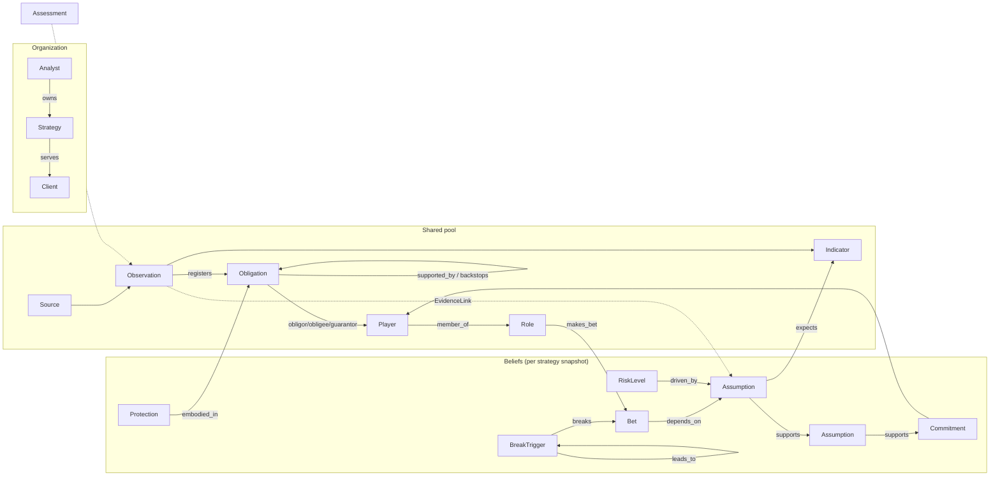

# Verity Investments · Decision Watch: Architecture and Ontology

> **Revision 3 (dw, 2026-10-05).** Copied from `longreach/test7/docs/ONTOLOGY.md` and updated for
> Demo 1 and the pitch (`pitch-2026-09.md`). What changed is listed in §15. Persistence is designed
> in `DATA-LAYER.md`; remaining gaps are in `GAPS.md`.

Decision Watch is a diagnostic tool for the analysts of Verity Investments ("Verity"), a
fictional investment firm. Each analyst keeps, for each client, one or more **strategies**: what
the client has invested in, a model of the industry behind it, the bets the industry's players are making,
and the assumptions those bets need. All strategies draw on one **shared pool of observations**.
The tool tells the analyst when reported reality starts to move away from what a strategy
assumed or predicted.

This is the third iteration of Decision Watch. The first (test6 and the earlier test7 design)
tracked one advisor's reasons for each client decision against signals. The second (test7)
added a model of the industry and its contracts, analyst-owned beliefs saved as snapshots, a
shared evidence pool, and provenance on every record. This one (dw) organizes everything around
one primitive, the **decision object** (§1.1): a commitment, the causal chain of reasons that
earned it, what was expected, what happened, the diff, what is exposed, who can reconsider, and
what was done.

The first domain is AI infrastructure, seeded from Devansh, *The AI Bubble Isn't Where You Think
It Is* (2026-09-27, `ai-bubble-devansh-2026-09.md`) and its infographics. The second is energy.

No code yet. This document defines the ontology, how time and provenance work, the demo data,
and the queries the design has to answer. §13 reviews the ontology for expressiveness against
maintenance cost. §14 lists what it implies for the analyst's UI. §15 records what changed in
revision 3.

---

## 1. Design principles

1. **Evidence is shared; beliefs are owned.** Observations, and the world model built from them,
   are one firm-wide pool. Beliefs (assumptions, predictions, risk levels, positions) belong to
   one strategy, owned by one analyst, for one client.
2. **Beliefs and evidence are separate stores.** Beliefs are a versioned model the analyst
   edits. Observations are an append-only log nobody edits. The diagnostic compares the two, so
   we can always ask "was I wrong, or did the facts change?"
3. **Beliefs are versioned as snapshots.** Each strategy has a history of dated snapshots. Any
   two can be diffed, and any old one can be re-run against today's evidence.
4. **Every fact has a source and two dates**: when it was true in the world, and when we learned
   it. Queries can ask "as of" either one.
5. **Every record says where it came from**: external, analyst, AI, or derived. Only external
   records can be facts. AI opinions are never blended into other records (§3).
6. **No blind scores.** Evidence stays a collection the analyst can expand. Any collapsed value
   carries the origins and kinds of its inputs and links to each one.
7. **Risk moves along contracts.** Obligations between players (contracts, leases, loans,
   guarantees) are first-class entities, because that is how risk passes between them.
8. **The tool suggests, the analyst decides.** Only the owning analyst's review changes a
   strategy.
9. **Cheap to maintain.** Author only what a person decides or a source reports. Everything
   else is computed at load. Defaults are set once per change set, not per record.
10. **Reasons form a graph.** The why behind a commitment is a directed acyclic graph of
    assumptions, each supporting the next, ending at the commitment. A broken reason affects
    everything downstream of it, and that reach is computed, never written by hand.
11. **Exposure is computed from commitments.** Money (or time, or headcount) is attached to commitments.
    An assumption's exposure is what is downstream of it, so "this assumption carries $50M" is a
    traversal, not an estimate.

### 1.1 The decision object

Every demo and every view is a view of one primitive. Each part maps to existing entities:

| Part | Question | Entities |
|---|---|---|
| **WHAT** | what did we decide or commit to? | Commitment (§4.5; Position is one kind) |
| **WHY** | what assumptions and causal logic earned it? | Assumptions linked by `supports`; Bets group them by role |
| **EXPECT** | what should happen? | an Assumption's expectation (indicator, rule, threshold, tolerance) |
| **EVIDENCE** | what actually happened? | Observations, measuring Indicators; EvidenceLinks |
| **DIFF** | where did reality depart? | computed: rule stances, Watch state, support state (§4.7) |
| **EXPOSURE** | what is economically affected? | computed from Commitment `size` through `supports` (§4.7) |
| **AUTHORITY** | who can reconsider? | `authorizes` links from a person or role to a Commitment |
| **ACTION** | what happened next? | Reviews, change sets, snapshots; later Outcomes (§15.1, planned) |

Demo 1 shows WHAT, WHY, EXPECT, EVIDENCE, DIFF, EXPOSURE and AUTHORITY on one screen. Demo 2
(budgets) and Demo 3 (processes) use the same object with other Commitment kinds
(`longreach/test7/docs/DEMO2.md`, `DEMO3.md`).

---

## 2. Architecture

```
                         SHARED (firm-wide)                            OWNED (per strategy)
  Public sources     ┌────────────────────────────┐       ┌──────────────────────────────────┐
  (filings, news, ──►│ Evidence                   │       │ Strategy  (analyst · client ·    │
   ratings, notes)   │  Source · Observation      │       │            domain)               │
        │            │  Indicator                 │       │  base snapshot + change sets     │
        ▼            ├────────────────────────────┤       │   Position · Bet · Assumption    │
  Manual intake ───► │ World model                │       │   RiskLevel · Protection         │
  (demo; automated   │  Player · Asset · Obligation│      │   BreakTrigger · Scenario        │
   later)            ├────────────────────────────┤       │  Evidence links (analyst, AI)    │
                     │ Domains: Role · RiskType   │       │  Reviews · AI suggestions        │
                     ├────────────────────────────┤       └────────────────┬─────────────────┘
                     │ Assessments (analyst, AI)  │                        │
                     └──────────────┬─────────────┘                        │
                                    └──────────────┬───────────────────────┘
                                                   ▼
                          ┌────────────────────────────────────────────────┐
                          │ Diagnostic engine (in the browser, at load)    │
                          │  evaluate(strategy, snapshot S, as of T)       │
                          │  → rule links, evidence sets, derived scores,  │
                          │    alerts with suggested actions               │
                          └────────────────────────┬───────────────────────┘
                                                   ▼
                          Review by the owning analyst → change set → new snapshot
```

| Part | Scope | Authored by | Changes |
|---|---|---|---|
| **Organization** | firm | admin | rarely |
| **Domains** | shared | analyst (lead) | rarely |
| **Evidence** | shared | whoever does intake | append-only; corrections supersede |
| **World model** | shared | whoever does intake | only via observations that register or amend |
| **Assessments** | the assessor | analyst, AI | append-only |
| **Beliefs** | one strategy | analyst | base snapshot, then change sets |
| **Evidence links, AI suggestions, reviews** | one strategy | analyst, AI | append-only |
| **Diagnostics** | one strategy | computed | never stored |

---

## 3. Provenance and epistemic kind

Every record is classified on two axes: **origin** (who produced it) and **kind** (what sort of
claim it is). Both are shown in the UI and passed to anything that consumes the record.

### 3.1 Origins

| Origin | Who | Can be a fact? | Examples |
|---|---|---|---|
| **external** | a named source outside Verity | yes | a 10-Q figure; an FT report of OpenAI's forecast; an S&P rating; Devansh's article |
| **analyst** | a named Verity analyst | no, always opinion | assumptions, predictions, convictions, positions, risk levels, evidence judgments, credibility assessments, reviews |
| **ai** | Verity's AI, identified by agent, model, version | no, always opinion | a suggested stance, a suggested assessment, a suggested assumption, a summary |
| **derived** | a named rule in the tool | inherits from inputs | a rule evidence link, a count, a ratio indicator, a concentration total |

- **Not blended.** An AI opinion is never written into an analyst or external record. When the
  analyst agrees with one, a new analyst record is created with `based_on` the AI record, and
  the AI record stays.
- **Credibility is an opinion.** How far to trust a source or observation is an Assessment by an
  analyst or the AI, not a property of the source.
- **Recorded-by is separate from origin.** An FT figure typed in by an analyst has origin
  external, `recorded_by` the analyst. Extracted later by the AI, it has origin external,
  `recorded_by` the AI, and `verified: false` until an analyst checks it against the excerpt.
- **Derived records inherit** the union of their inputs' origins and kinds.

### 3.2 Kinds

| Kind | Origins | Example | Tested how |
|---|---|---|---|
| fact | external | CoreWeave: 98% of Q2 revenue from committed contracts (10-Q) | corroboration; superseded by corrections |
| prediction (reported) | external | OpenAI expects ~$350B revenue by 2030 (FT) | against later facts; revisions are signals |
| stated premise | external | OpenAI: Ohio commitments funded by future cash flow plus capital raised | watched for restatement or withdrawal |
| opinion (reported) | external | S&P: unsecured recovery ~10–30%; S&P downgrades Oracle to BBB- | evidence, weighed by our assessment |
| assumption | analyst | "OpenAI keeps raising outside capital on schedule through 2028" | continuously |
| prediction | analyst | "Oracle 12-month RPO conversion stays ≤ 15%", resolves 2027-06-30 | once, on its date |
| judgment | analyst, ai | "this Reuters report weakens our OpenAI funding assumption" | recorded as given |
| assessment | analyst, ai | "FT reports of private-company forecasts: medium" | recorded as given |
| derived | derived | CoreWeave contracted revenue / debt ≈ 2.9× | recomputed |

### 3.3 The provenance block

| Field | Meaning |
|---|---|
| `origin` | external · analyst · ai · derived |
| `kind` | from §3.2 |
| `by` | source; analyst ID; AI agent + model + version + run ID; or rule ID |
| `at` | when produced |
| `recorded_by`, `recorded_at` | who entered it, and when |
| `based_on` | records it was built from |
| `inputs`, `origins`, `kinds` | derived only: every input, and the union of their origins and kinds |
| `verified` | AI-recorded external records only |
| `synthetic` | true for demo records we invented (§11) |

**Defaults per file.** Each YAML file declares a provenance header that applies to every record
in it (for example, all of `strategies/<id>/links/analyst.yml` is origin analyst, by
`analyst.priya-raman`). A record states provenance fields only where it differs. Every record
still has the full block logically, without anyone writing it on every record by hand.

In the UI every value has a provenance mark: *External · fact · SEC 10-Q*, *Analyst · opinion ·
Priya Raman*, *AI · opinion · unreviewed*, *Derived · external facts + analyst opinion*. Derived
marks open their inputs.

---

## 4. Entity classes

IDs are stable, readable, globally unique slugs: `player.coreweave`,
`asm.pension-credit.openai-capital-access`. Belief IDs carry the strategy's short name.

### 4.1 Organization

**Firm**: `id`, `name` (Verity Investments), `short_name` (Verity). One brand file.

**Analyst**: `id`, `name`, `title`. The demo has one: Priya Raman.

**Client**: whom a strategy is for (a pension fund, an endowment, a family office). `id`,
`name`, `analyst`, `description`, `review_cadence` (for example quarterly).

**Meeting**: a dated meeting between the analyst and a client. `id`, `client`, `date`,
`strategies` (each with the snapshot presented), `notes`. Origin analyst. Past meetings mark
which snapshot the client agreed to; the next meeting tells Watch how much time is left to act
on a gap.

**Strategy**: one investment thesis model, for one client, in one domain, owned by one analyst.
The unit that has snapshots, evidence links, reviews, and alerts.
- `id`, `name`, `short_name`, `domain`, `analyst`, `client` (none for a template), `status`
  (active · paused · closed), `created_at`
- `forked_from`: the template snapshot it was copied from (optional)
- `visibility`: private · firm. Analysts will see each other's strategies later; the demo has
  one analyst and does not build this.

A client can have several strategies (AI and energy), and a domain can have several strategies
with different positions in it. A strategy with no client is a **template** (the Devansh seed),
which the analyst forks into client strategies. Forked beliefs keep `forked_from` links to the
template's, so divergence from the template is a query.

### 4.2 Domains (shared)

**Domain**: `id`, `name`. Defines the roles and domain risk types its strategies use.

**Role**: a position in a domain's value chain. AI infrastructure starts with the article's six
plus one cross-cutting layer:

| Role | Plain English | Key players (seed) |
|---|---|---|
| Model lab | build models and products; the end of the chain that has to earn the money | OpenAI, Anthropic |
| Hyperscaler | cloud compute and infrastructure at scale | Oracle, Google, Microsoft, AWS |
| Neocloud / GPU operator | rent and operate large GPU clusters | CoreWeave, IREN |
| Data-center landlord | own and develop the physical infrastructure | Applied Digital, Core Scientific |
| Chip supplier | design and sell the hardware | Nvidia, Broadcom |
| Lender / private credit | debt, project finance, other capital | banks, credit funds, Apollo, Blackstone |
| Capital markets (cross-cutting) | equity, debt, and guarantees under every layer | SoftBank, public equity and bond markets |

The energy domain's roles (generator, grid operator, power offtaker, developer) are defined in
the demo data. Some players have roles in both domains (SB Energy; hyperscalers as power
offtakers).

**RiskType**: controlled vocabulary; common types shared, domains may add their own.

| RiskType | Question it asks |
|---|---|
| pricing | what happens when the market price falls? |
| utilization | what happens when capacity goes unused? |
| counterparty | what happens when the payer cannot pay, or finds a way not to? |
| renewal | what happens when the protected period ends? |
| funding | is capital available when needed, and is debt still there when protection ends? |
| construction | can it be built and powered on time and on budget? |
| obsolescence | does new technology reset the asset's economics? |
| concentration | how much depends on a few customers? |
| returns | does the spending earn an acceptable return? |
| balance sheet | how much room is there to be wrong? |
| spillover | how much does this player's failure hurt others? |
| demand | is there enough end demand? |

### 4.3 Evidence (shared)

**Source**: who publishes. `id`, `name`, `source_type` (regulatory filing · company release ·
rating agency · news · newsletter · data vendor), `fictional` (true for invented demo sources,
§11). Trust in a source is an Assessment, not a field.

**Observation**: one reported claim, the atomic unit of evidence. Observations are grouped by
the document they came from; the document's fields (`url`, `title`, `published_at`, `source`)
are stated once for the group.
- `id`, `excerpt` (exact quote), `kind` (§3.2), `attributed_to` (for reported predictions and
  premises: who made the claim)
- `form`: **measurement** or **event**
  - measurement: `indicator`, `value`, `qualifier` (exact · approx · at least · at most ·
    range with `low` / `high`), `unit`
  - event: `event_type` (deal signed · deal amended · rating action · funding round · default ·
    price change · guidance change · capacity online · delay), `parties`
- `subject`: the Player / Obligation / Asset it is about
- `valid_time`: the period or date the claim is about
- `published_at` (from its document), `recorded_at`
- `supersedes`: an earlier observation it corrects
- `registers` / `amends`: the Obligation, Asset, or RoleMembership it creates or changes
- `status`: accepted · rejected; later, `candidate` for automated intake

**Indicator**: a named measurable series, shared across strategies.
- `id`, `name`, `unit`, `subject`, `period_type` (point · quarter · trailing 12 months · fiscal
  year · run-rate), `direction_of_concern` (up · down · either), `domains`
- `derivation` (optional): formula over other indicators; its values are derived observations

### 4.4 World model (shared)

**Player**: a company or fund. `id`, `name`, `aliases`, `parent` (Alphabet → Google Cloud),
`ticker`, `plain_english`, and **RoleMembership** records (`role`, `from`, `to`). Membership is
dated because players change roles (Core Scientific: bitcoin mining → AI colocation).

**Asset**: something with value and a life, used as collateral or to compare clocks. `id`,
`type` (GPU fleet · data-center campus · power capacity · rack deployment), `owner`, `location`,
`capacity_mw`, `build_cost`, `in_service_date`, `economic_life`, `accounting_life`,
`technology_generation`. Optional: record an asset only when an obligation or assumption refers
to it.

**Obligation**: a contract that moves money and risk between players.
- `id`, `type`: compute contract · lease · debt facility · guarantee · capacity purchase
  commitment · prepayment · financing platform · equity raise
- `obligor`, `obligee`, `guarantor`, `arranger` (as applicable)
- `notional`, `currency`, `signed_at`, `start`, `end`, `schedule`
- `status`: announced · signed · in force · amended · expired · defaulted · terminated
- `terms`: type-specific fields (take-or-pay, prepaid share, seniority, spread or coupon,
  covenants, cap, phase-in, reimbursement, escalators)
- `supported_by` → Obligations whose cash repays it
- `secured_by` → Assets
- `backstops` → Obligation (for guarantees)
- `introduced_by`: the observation that registered it

`ultimately_depends_on` (derived): the end payer found by following `supported_by` and
`backstops`. This is the "different wrappers, same underlying customers" query.

The article's **five clocks** need no entity: they are the technology generation, contract
`end`, debt `end`, accounting life, and lease `end` already recorded.

### 4.5 Beliefs (per strategy, snapshotted)

All beliefs are analyst records. A belief adopted from an AI suggestion keeps `based_on` it.
Beliefs refer freely to shared entities, never to another strategy's beliefs except through
`forked_from`. Each snapshot also has a `thesis`: a one-sentence statement of the strategy's
view.

**Commitment**: what was decided, the WHAT of the decision object. It ties beliefs to money,
time, or people.
- `kind`: **position** (an investment; was "Position") · **budget** (an authorized spend, Demo 2) ·
  **process** (a standing way of working, Demo 3)
- `subject`: a Player, Obligation, or instrument class ("Halberd Compute, growth equity", "senior
  secured GPU-backed project debt")
- `stance` (positions): hold · overweight · underweight · avoid · lend · long · short · invest
- `size`: `{ amount, currency }` for money; required for exposure. Demo 2 adds `spent` and
  `committed`; Demo 3 adds unit cost and cycle time.
- `decided_on`, `term` (`start`, `end`), `next_review`
- `rationale`
- Authority comes from `authorizes` links (below), not a field, so one body can hold authority
  over many commitments and changes of authority are versioned.
- Reasons attach by `supports` links **into** the commitment (below). The old `relies_on` link
  (Position → Assumption) is replaced by `supports` in the other direction, so the whole WHY is one
  graph with one link type.

**Authority** (link `authorizes`): a person or role → a Commitment, with `authority`: decide ·
review · inform. Demo 1: *Verity Investment Committee* decides on *Invest $50M in Halberd*. This is
how changed evidence is routed "to someone who can actually do something about it" (pitch).

**Bet**: what a role or a specific player is wagering on.
- `holder` (Role, or Player where it differs from its role: Oracle "bets twice")
- `statement`, `plain_english`
- `depends_on` → Assumptions, each `necessary` or `supporting`

**Assumption**: an atomic claim the strategy relies on. One entity covers both standing
assumptions and predictions. Assumptions are linked to each other and to commitments by
**`supports`** links, forming the causal WHY (principle 10).
- `type`: **assumption** (a premise, tested continuously) or **prediction** (a claim about a
  future value, tested once)
- `statement`, `plain_english`, `about`, `rationale`
- `conviction`: low · medium · high, how strongly the analyst believes it
- `expectation` (optional, the machine-checkable form): `indicator`, `rule` (at least · at most ·
  within band · trend up / down / flat over a window), `threshold`, `tolerance` (how far past
  counts as contradicting rather than weakening), `min_credibility` (optional). Without an
  expectation, the assumption is qualitative and only judged links bear on it.
- predictions add `resolves_on` and `outcome` (pending · confirmed · missed · void), set from
  the first accepted observation for the resolution period
- `review_by`: date after which it is stale without new evidence
- `adopted_from`: the observation it came from, if borrowed (a Devansh claim, company guidance)
- `forked_from`: the template assumption it was copied from
- expectation additions for Demo 1: `baseline` (the reading at the decision date, so "down 11%
  since Oct 1" is computed) and `tolerance_pct` as an alternative to an absolute tolerance
- **Premise or conclusion** is not a field: an assumption with incoming `supports` links is a
  conclusion (it is believed because of others, like "margins expand"); one without is a premise.
  A conclusion may also have its own expectation (margins have a reported number).

**Supports** (link): assumption → assumption, or assumption → commitment. "We believed B because of
A" is `A supports B`.
- `necessity`: **necessary** (if A breaks, B is at risk) or **supporting** (A breaking weakens B
  but does not put it at risk)
- `weight` (optional, low · medium · high): how much of B rests on A, for display and later
  learning; never used to compute a score
- `lag_days` (optional): how long A's change takes to reach B (pricing reaches margins with a
  quarter's lag)
- `note`
- The graph is **acyclic**; writes that would create a cycle are rejected.
- Bets remain: `depends_on` (Bet → Assumption) groups assumptions by role for the analyst views.
  `supports` is the causal structure; `depends_on` is the filing system.

**RiskLevel**: the analyst's view of a holder's exposure to a risk type. Sparse: recorded only
where the analyst has a view.
- `holder` (Role or Player), `risk_type`, `level` (1–5), `rationale`
- `driven_by` → Assumptions
- Seeded from the article's scorecards (Oracle: demand 1, funding 5, counterparty 5, balance
  sheet 4)

**Protection**: a mechanism that shields a holder from a risk.
- `mechanism`: take-or-pay · prepayment · covenant · collateral · cash trap · forced paydown ·
  guarantee cap · reimbursement right · seniority · balance-sheet cushion · diversified demand ·
  investment-grade tenants
- `holder`, `risk_types`
- `embodied_in` → Obligation (optional); `expires_at` derived from its end
- An expiring protection raises an alert with no news needed: Devansh's "risk delayed, not
  eliminated".

**BreakTrigger**: a condition that breaks a bet if it becomes true.
- `breaks` → Bet, `condition` (plain statement)
- `watched_by` → Indicators, each with a trip threshold; distances are reported separately,
  never combined
- `leads_to` → other BreakTriggers, with `lag`. This is how "what breaks first" chains are
  recorded: Oracle's "customer funding weakens" leads to Oracle's "buildout carried on balance
  sheet", which leads to the lenders' trigger. Chains can cross holders, so contagion is a
  traversal.

**Scenario**: a hypothetical shock. `shock`, `exposure` per Role (high · medium · low) with a
`key_insight`, `signposts` → Indicators. Seeded from the article's five-shock matrix.

**Watchlist**: named groups of indicators on the snapshot, for the analyst's first look. The
seed has the article's seven "what I would watch" items.

### 4.6 Evidence links, assessments, AI suggestions, reviews

**EvidenceLink**: one observation bearing on one assumption or break trigger.
- `observation`, `target`, `stance` (supports · weakens · contradicts · neutral), `note`
- `method`:
  - **rule** (origin derived): computed at load from the target's expectation; never stored
  - **judged** (origin analyst): stored; the only kind that counts for qualitative assumptions
  - **ai** (origin ai): stored; a suggested stance until the analyst adopts it as a judged link
- Stored links target beliefs by stable ID and are dated, so evaluating as of T uses only links
  made by T.

**Assessment**: an opinion on how far to trust a Source or an Observation.
- `target`, `rating` (high · medium · low), `note`; origin analyst or ai
- Owned by the assessor, not a strategy. The newest per assessor applies; history stays.
- Analyst and AI assessments are shown side by side, never merged. Only analyst assessments
  count toward an expectation's `min_credibility`.

**AISuggestion**: any other AI output: a suggested assumption, risk level, retirement, or a
summary of the evidence on a belief. `target`, `content`, `cites` (records used), `status`
(open · adopted · dismissed). Origin ai.

**Review**: the analyst's decision on an alert or AI suggestion: accept · modify · reject · no
change, with a note. Accepted and modified decisions produce **changes** (§6.2).

### 4.7 Diagnostics (computed at load, never stored)

**EvidenceSet**: all links for one target as of one date. Summary: counts by stance, split by
origin; the newest stance; flags `untested`, `stale`, `conflict` (two accepted observations of
one indicator and period disagree). Expanded: every link with its origin, observation, excerpt,
source, assessments, and dates, grouped by indicator.

**DerivedScore**: any collapsed value: a count, a concentration total, a source's assessment
roll-up. `value`, `method` (named, versioned rule), `as_of`, `inputs`, `origins`, `kinds`. Any
AI input makes it visibly AI-influenced. Never shown without its label.

**SupportState**: for each assumption and commitment as of T: *supported*, or *at risk* (a
necessary supporter is broken or itself at risk), or *weakened* (only supporting-link supporters
are broken). Propagated from premises to commitments in topological order. Kept separate from the
assumption's own Watch state, which comes from its own evidence. Display state: broken (own state
contradicting) > at risk > own state.

**Exposure**: for an assumption, the commitments reachable downstream along necessary `supports`
links, each counted once, and the sum of their `size`. Reported with the list of commitments it
came from; never shown without them (principle 6).

**Verdict**: the one-paragraph summary Demo 1 shows: which assumptions broke, the diff in words
(expected vs actual, change since baseline), how many downstream conclusions and commitments they
support, total exposure, the authority, and the next review. Generated from the above; a
DerivedScore with its inputs.

**Alert**: something changed: new weakening or contradicting evidence, a prediction resolved, a
trip threshold crossed, a protection expired, a concentration total changed, a conflict, an
assumption whose support state moved to at risk. It
carries the target's conviction and necessity, the origin of what raised it, and a
`suggested_action` (review a risk level via `driven_by`, lower conviction, retire, add an
assumption for a new obligation). AI links raise alerts only if the analyst opts in.

---

## 5. Relationships

**S** = shared, **O** = owned by a strategy, **A** = owned by an assessor.

| Relationship | From → To | Scope | Note |
|---|---|---|---|
| `owns` | Analyst → Strategy | O | |
| `serves` | Strategy → Client | O | none for templates |
| `presented` | Meeting → Strategy snapshot | O | what the client agreed to |
| `models` | Strategy → Domain | O | |
| `forked_from` | Strategy / belief → template snapshot / belief | O | |
| `defines` | Domain → Role, RiskType | S | |
| `published` | Source → Observation (via document) | S | |
| `measures` | Observation → Indicator | S | |
| `about` | Observation → Player / Obligation / Asset | S | |
| `supersedes` | Observation → Observation | S | |
| `registers` / `amends` | Observation → Obligation / Asset / RoleMembership | S | |
| `member_of` | Player → Role (dated) | S | |
| `parent` | Player → Player | S | |
| `obligor` / `obligee` / `guarantor` | Obligation → Player | S | |
| `supported_by` | Obligation → Obligation | S | |
| `secured_by` | Obligation → Asset | S | |
| `backstops` | Obligation → Obligation | S | |
| `ultimately_depends_on` | Obligation → Player | S | derived |
| `supports` | Assumption → Assumption / Commitment | O | necessity, weight, lag; acyclic; replaces `relies_on` |
| `authorizes` | Analyst / Role → Commitment | O | decide · review · inform |
| `makes_bet` | Role / Player → Bet | O | |
| `depends_on` | Bet → Assumption | O | necessary / supporting |
| `breaks` | BreakTrigger → Bet | O | |
| `leads_to` | BreakTrigger → BreakTrigger | O | with lag |
| `watched_by` | BreakTrigger / Scenario / Watchlist → Indicator | O | |
| `expects` | Assumption → Indicator | O | via expectation |
| `adopted_from` | Assumption → Observation | O → S | |
| `driven_by` | RiskLevel → Assumption | O | |
| `embodied_in` | Protection → Obligation | O → S | |
| `exposes` | Scenario → Role | O | |
| `bears_on` | EvidenceLink: Observation → Assumption / BreakTrigger | O → S | rule / judged / ai |
| `assesses` | Assessment → Source / Observation | A → S | |
| `suggests` | AISuggestion → belief | O | |
| `based_on` | any record → records it was built from | any | |
| `inputs` | derived record → inputs | any | |
| `decides` | Review → Alert / AISuggestion | O | |



---

## 6. Time and versioning

### 6.1 Two time axes for evidence

| Axis | Field | Question |
|---|---|---|
| Valid time | `valid_time` | what period is this about? |
| Knowledge time | `published_at`, `recorded_at` | when could we have known it? |

Observations are never edited. Corrections are new observations with `supersedes`.

### 6.2 Snapshots as change sets

- A strategy has one **base snapshot** (complete, usually forked from the template) and then a
  sequence of **change sets**. Snapshot N is the base with change sets 1..N applied, computed
  at load. Complete copies are never written by hand.
- A change set is: `id`, `at`, `note`, `trigger` (scheduled review · alert · manual),
  `reviews` (that led to it), and a list of **changes** by belief ID.
- Change types, which are also the diff categories:

| Change | Example |
|---|---|
| add | new assumption about Anthropic's compute commitments |
| retire (with reason) | "OpenAI raises on schedule" retired as contradicted |
| reword | statement edited, meaning unchanged |
| set conviction | medium → low |
| set expectation | threshold moved (flagged: moving the goalposts) |
| relink | dependency added, removed, or changed between necessary and supporting |
| set risk level | Oracle counterparty 4 → 5 |
| set position | underweight → avoid CoreWeave unsecured notes |
| set thesis | thesis restated |

- Retired beliefs stay in later snapshots, marked retired, so history reads cleanly.
- Diffing S1 → S2 is listing the change sets between them. Each change links to its reviews,
  alerts, and the observations behind them, so "why did we raise Oracle's funding risk in
  October?" has an answer.
- Diffs across strategies work for beliefs that share a `forked_from` origin.

### 6.3 Evaluation takes two times

`evaluate(strategy, snapshot S, as of T)` uses beliefs from S and only evidence, links, and
assessments recorded by T.

| S | T | Question |
|---|---|---|
| latest | now | where does this strategy stand? |
| 3 months ago | then | what did the analyst see at the time? |
| 3 months ago | now | how has reality moved against what was believed then? |
| latest | 3 months ago | would today's model have raised alerts earlier? |

---

## 7. Diagnostic rules

1. **Rule links.** For each assumption with an expectation, each accepted observation of its
   indicator gets a stance: inside the threshold → supports; past it by less than the tolerance,
   or trending toward it → weakens; past it by more → contradicts. One link per observation.
2. **Stored links** (judged, AI) are filtered to those made by T and kept apart by origin.
3. **Evidence sets and counts** are DerivedScores with inputs and origins.
4. **Predictions** resolve from the first accepted observation for their resolution period.
5. **Break triggers** report each indicator's distance to its trip threshold. `leads_to` shows
   what is next in the chain.
6. **Protection expiry** is checked every run.
7. **Concentration** (`ultimately_depends_on` totals) is recomputed when obligations change.
8. **One observation, many strategies.** Each new observation is checked against every active
   strategy; each gets its own links and alerts.
9. **Support propagation.** After own states are known, support states are computed in
   topological order over `supports` (§4.7). A cycle is a data error, caught at write time.
10. **Exposure** is summed per broken or at-risk assumption over the commitments it reaches;
    commitments without a size are listed but contribute nothing, and the total says so.
11. **Diff against baseline.** Where an expectation has a `baseline`, the diff reports change since
    the decision date as well as distance from the threshold.

---

## 8. Queries

Within a strategy:

1. Which assumptions have new weakening or contradicting evidence, by conviction and necessity?
2. All evidence for one assumption, grouped by indicator, newest first.
3. What changed between two snapshots, and which observations and reviews drove it?
4. Per end payer: how much notional across all roles ultimately depends on it?
5. Which debt facilities outlive their supporting contracts, and by how much principal?
6. Which protections expire in the next 12 months, and what do they shield?
7. Which break-trigger indicators are nearest their trip thresholds, and what do they lead to?
8. Which predictions resolve this quarter; hit rate by origin (own, Devansh, company guidance)?
9. Which assumptions are stale?
10. Where have new guarantees appeared, and who carries them?
11. For a scenario, which players are exposed, through which obligations, and what comes next?
12. How has a player's borrowing spread moved relative to peers or its other facilities?
13. Which commitments are downstream of an assumption that is weakening or contradicted, and
    how much exposure does it carry? (Demo 1's verdict.)
    Also: which conclusions are at risk only because of an upstream break, before their own
    evidence arrives?

Across strategies:

14. Which strategies and clients does a new observation bear on, and with what stance in each?
15. How many strategies have a necessary assumption depending on the same player? (the
    concentration problem, one level up: across Verity's own book)
16. Where do two strategies disagree about the same player?
17. How has each strategy diverged from its template?
18. For one client, the state of all their strategies across domains.

Provenance:

19. For any value, its origin and kind, and for derived values every input down to excerpts.
20. Which beliefs were adopted from AI suggestions; which AI suggestions are open?
21. Where do the analyst's and the AI's assessments of a source disagree?
22. Which derived scores include AI input?

---

## 9. Worked example: CoreWeave's $2.6B facility

† = from the article; other values are illustrative.

| Entity | Record |
|---|---|
| Obligation | `obl.coreweave.ddtl-5.5`: debt facility, $2.6B†, SOFR+5.5%†, ~5 yr†, DSCR ≥ 1.35׆; `supported_by` `obl.coreweave.ddtl-5.5.contracts` (compute contracts, ~3 yr†) |
| Protection | take-or-pay on the supporting contracts; CoreWeave pricing risk; expires at contract end |
| Bet | neocloud: "Recover upfront costs before contracts and compute economics reset"† |
| Assumption | `asm.pension-credit.coreweave-concentration`: top-3 customer share ≤ 75%, tolerance 5 pp, conviction medium (72% in Q2†) |
| Assumption | `asm.pension-credit.coreweave-renewal-pricing`: renewal price ≥ 70% of original, conviction medium |
| BreakTrigger | "Contract protection expires while debt remains"†; `leads_to` the lenders' "forced paydown or refinancing at higher spread" |
| Position | Harlow County pension: lend, senior secured GPU-backed project debt; avoid CoreWeave unsecured notes |
| Second strategy | the family office's equity strategy sets the same concentration threshold at 80%, conviction high. The next 10-Q observation yields two rule links, possibly different stances (query 16) |
| Provenance | the 10-Q value: *External · fact · SEC*. Priya's rating of it: *Analyst · opinion*. Each rule stance: *Derived · external fact + analyst opinion*. An AI note that the largest customer is likely Microsoft: *AI · opinion*, in the AI file |
| Diagnostic | query 5 finds ~2 years of debt without contracted support; at contract end an alert suggests reviewing renewal and funding risk levels |

---

## 10. Seed template: Devansh thesis v1

`strategy.template.devansh-ai`, base snapshot dated 2026-09-28, from the article's "AI Risk Map".
Each row becomes a Bet, its Assumptions, Protections, and a BreakTrigger, all `adopted_from`
observations of the article. The scenario matrix seeds Scenarios; the scorecards seed
RiskLevels; "What I would watch" seeds the Watchlist.

| Role | Bet | Main risks | Protection | Break trigger | Key facts |
|---|---|---|---|---|---|
| Model labs | usage and revenue grow fast enough to support huge compute commitments | funding, margins, falling AI prices, failure to grow into commitments | enormous demand, capital access, falling inference costs, ability to switch providers | fundraising slows before cash generation catches up | OpenAI ~$36B 2026 revenue (projected), ~$278B negative FCF 2026–30; Anthropic >$47B run-rate |
| Hyperscalers | customers consume enough cloud to justify today's capex | overbuilding, poor ROI, customer quality, upfront capex, funding | cash machines; customer prepayments and hardware (Oracle) | customers consume less than promised + capex stays high + financing gets expensive | Oracle $664B RPO, 13% in 12 months; Google Cloud $513.9B backlog |
| Neoclouds | recover upfront costs before contracts and compute economics reset | renewal pricing, leverage, concentration, refinancing, GPU residual value | take-or-pay, prepayments, secured financing, forced amortization | contract protection expires while debt or capex obligations remain | CoreWeave 98% committed revenue Q2; top-3 = 72% |
| Data-center landlords | the infrastructure stays useful and the tenant keeps paying | construction, power, tenant concentration, tenant default, financing before completion | long leases, take-or-pay, reusable power-connected sites, investment-grade tenants | the tenant, not the technology | Applied Digital ~$36B contracted, ~70% investment-grade; Core Scientific: CoreWeave = 77% of revenue |
| Chip suppliers | financing expands the market enough that extra sales outweigh contingent risk | customer default, guarantees, capacity-purchase commitments, weak hardware recovery | margins, cash generation, diversified demand, guarantee caps, recovery rights | major customer failure + weak replacement demand + collapsing asset values | Broadcom backstop ≤ ~$29B; Nvidia guarantee ≤ $105B; Nvidia $36B capacity commitments |
| Lenders | get repaid before the rest of the structure deteriorates | counterparty default, contract expiry, collateral recovery, correlated exposure | first claims on cash, collateral, covenants, cash traps, mandatory repayments, equity beneath them | borrower fails after equity, guarantees, trapped cash, and collateral are exhausted | CoreWeave project loan SOFR+2.25% vs +5.5%; unsecured 9.625%, recovery 10–30% |

---

## 11. Demo data

### 11.1 Cast

| | Demo record |
|---|---|
| Firm | Verity Investments ("Verity") |
| Analyst | Priya Raman |
| Client 1 | Harlow County Teachers' Pension: lends through private credit |
| Client 2 | Okafor Family Office: public equities |
| Client 3 | Lakemont University Endowment: real assets |
| Template | Devansh thesis v1 |
| AI strategy 1 | Harlow pension, *AI infrastructure credit*: senior secured project debt, avoids unsecured neocloud paper |
| AI strategy 2 | Okafor family office, *AI stack equity*: chip suppliers and hyperscalers, underweight Oracle |
| AI strategy 3 | Lakemont endowment, *AI data-center real assets*: landlord exposure, tenant credit focus |
| Energy strategy | Lakemont endowment, *power for data centers*: generation and grid assets serving AI load; shares players (hyperscalers, SB Energy) and indicators with the AI strategies |

All names are fictional. The three AI strategies are forked from the template and diverge, so
one observation shows up differently in each.

### 11.2 Synthetic records

The demo covers the six months from the article to demo "today", 2027-03-31. Records
from the article are real and cited. Everything else is synthetic, generated in volume, and
marked `synthetic: true`.

| Origin | What | Rough volume |
|---|---|---|
| external, real | observations taken from the Devansh article and the filings it cites | ~80 |
| external, synthetic | quarterly results, deals, rating actions, guidance changes, price moves, for real players, attributed to **fictional sources** | ~250 across ~60 documents |
| analyst | positions, assumptions, risk levels, judged links, assessments, reviews, change sets (4–6 per strategy) | ~400 |
| ai | suggested stances, assessments that sometimes disagree with Priya's, open and dismissed suggestions, evidence summaries | ~150 |
| derived | computed at load | (not stored) |

**Rule for synthetic external records:** they are attributed only to fictional sources (for
example *Meridian Credit Wire*, *Northgate Research*), never to real publishers such as Reuters,
FT, or the SEC. Invented claims about real companies are never presented as coming from a real
outlet. Every synthetic record is labeled in the UI, and the footer states that the demo mixes
cited public facts with fictional data.

The storyline should give the diagnostic something to find: for example, OpenAI's next round
slips; a CoreWeave renewal prices lower; a new Nvidia backstop appears; one energy interconnect
is delayed. Some assumptions should stay supported, so not everything is alarming.

### 11.3 Files (test7 layout; superseded)

Revision 3 stores the ontology as a versioned graph (`DATA-LAYER.md`): node and link types in a
registry, every write in a change set, seeds as one YAML file per change set (DATA-LAYER §7). The
per-file provenance header below becomes the change set's provenance defaults. The layout is kept
for reference.

```
public/api/
  brand.yml
  org/            firm.yml  analysts.yml  clients.yml  strategies.yml  meetings.yml
  domains/        risk-types.yml  ai-infrastructure.yml  energy.yml
  evidence/
    sources.yml   indicators.yml
    documents/<doc-id>.yml          one document and its observations
  world/          players.yml  assets.yml  obligations.yml
  assessments/    analyst-priya-raman.yml  ai.yml
  strategies/<strategy-id>/
    base.yml                        base snapshot
    changes/<date>-<slug>.yml       one change set each
    links/analyst.yml               judged evidence links
    links/ai.yml                    AI evidence links
    ai-suggestions.yml
    reviews.yml
```

Each file has a provenance header (§3.3). No file mixes origins. A build-time check validates
every ID reference and rejects: records without provenance, analyst or AI records of kind fact,
synthetic records attributed to a non-fictional source, and change sets that modify a belief
that does not exist yet.

---

## 12. Decisions and open questions

**Decided:**
- This is the next iteration of Decision Watch, in test7. The earlier design and plan are
  retired.
- Firm: Verity Investments ("Verity"). One analyst, three clients, one template, three AI
  strategies, one energy strategy. Cross-analyst visibility later, not in the demo.
- Static YAML files; manual intake for the demo; automation later.
- Provenance on every record: external, analyst, AI, derived. Only external records are facts.
- No blind scores: collapsed values carry their inputs and origins.
- Demo includes many synthetic records of all origins (§11.2).
- Synthetic external records are attributed only to fictional sources (§11.2).
- Demo "today" is 2027-03-31: six months after the article, two quarterly reporting cycles.
- Which of the existing test7 code to keep is decided when we plan the build.

**Open:**
1. **Bet granularity.** Per role, plus per player where the article scores them differently
   (Oracle vs Google). The seed uses both.

---

## 13. Review: expressive enough, cheap enough?

### 13.1 What changed in this pass

| Change | Why |
|---|---|
| Assumption and Prediction merged into one entity with `type` | same fields, same links; one editor, one list |
| Conviction is low · medium · high, not 0–1 | analysts do not distinguish 0.6 from 0.65; words are faster and honest |
| Team removed | one analyst in the demo; add when there are teams |
| Thesis and Watchlist became fields on the snapshot | each was one value per strategy |
| CausalLink and the undefined "Condition" replaced by `BreakTrigger.leads_to` | chains now link real entities and can cross holders |
| ProposedChange folded into Alert's `suggested_action` | alert, proposal, and AI suggestion overlapped |
| Document folded into the observation file; Assessments target Source or Observation only | fewer levels to assess and navigate |
| Snapshots stored as base + change sets | no duplicated copies to keep consistent; diffs come for free; each change has a reason |
| Provenance set per file | the rule stays on every record without hand-writing it |
| Asset made optional; RiskLevel sparse | record only what an obligation or the analyst actually uses |
| **Added** Position | without it, nothing tied a strategy to the client's money; the analyst could not ask "which holdings rely on this assumption?" (query 13) |
| **Added** value qualifiers (approx, at least, range) | the sources say "~$36B", ">$300B", "10–30%" |
| **Added** Player `aliases` and `parent` | Alphabet / Google Cloud, Amazon / AWS |

### 13.2 What the analyst maintains

| Record | Who | How often | Effort |
|---|---|---|---|
| Observations and world model | intake (analyst now, AI later) | as news comes in | main ongoing cost; one file per document |
| Evidence judgments | analyst | as news comes in, only for qualitative assumptions | small if most assumptions have expectations |
| Assessments | analyst | when a new source appears or one surprises | small |
| Change sets | analyst | at reviews | small; driven by alerts |
| Base snapshot | analyst | once per strategy (usually a fork) | one-time |
| Domains, risk types | lead analyst | rarely | one-time |
| Everything derived | nobody | at load | none |

Intake is the main cost. The design keeps it contained: each news item is one file, and the
same shape later accepts AI-extracted candidates.

### 13.3 Deliberately left out

- Probabilities and Bayesian updating: the tool shows evidence, the analyst updates conviction.
- Competing hypotheses inside one strategy: use two strategies (or two forks of the template).
- Currency conversion: amounts are stored in their reported currency.
- Automated entity resolution: aliases are entered by hand.
- Cross-analyst visibility and permissions.

### 13.4 Watch for

- **Expectation coverage.** Qualitative assumptions need a judged link for every relevant
  observation. If most assumptions are qualitative, judging becomes the analyst's main chore.
  The seed should give expectations to as many assumptions as the indicators allow.
- **Indicator sprawl.** Indicators are shared; without care, near-duplicates appear. Intake
  should pick an existing indicator before making one.
- **Stable IDs after rewording.** Judged links point at a belief ID. If a reword changes
  meaning, it should be a retire + add, not a reword, so old judgments do not attach to a new
  claim.

---

## 14. For the next phase: the analyst's UI

The ontology suggests where the analyst will spend time, and so what the UI has to make fast.

**Places to navigate from:**
- **Strategy home**: thesis, positions, alerts, the assumptions under pressure.
- **Assumption page**: the claim, its expectation, its evidence set (expandable, by origin), what
  relies on it (bets, positions, risk levels), its history across snapshots.
- **Player page**: roles, obligations in and out, indicators, and every strategy's beliefs about
  it, side by side.
- **Obligation graph**: `supported_by`, `backstops`, `ultimately_depends_on`; the five clocks
  on one timeline.
- **Evidence inbox**: new observations, each showing which strategies and assumptions it bears
  on, with AI suggestions labeled.
- **History**: change sets as a timeline, each with its reasons; diff any two points.

**Edits that must be quick** (frequent): judge a link, adopt or dismiss an AI suggestion, change
a conviction or a risk level, accept an alert's suggested action. Each is one analyst record and,
where it changes a belief, one change in the draft change set.

**Edits that can be slower** (rare): new assumptions and expectations, new strategies, forking,
domain vocabulary.

**Everywhere:** provenance marks on every value, drill-down from every derived number, and an
"as of" control for both the snapshot and the evidence date.

---

## 15. Revision 3 (dw): what changed and why

Driven by Demo 1 (`DEMO1.md`) and the pitch (`pitch-2026-09.md`); full gap analysis in `GAPS.md`.

| Change | Why |
|---|---|
| **Decision object** (§1.1) as the organizing primitive | one product behind three demos; each demo is a view of it |
| **`supports` links between assumptions and into commitments** (causal WHY, acyclic, with necessity, weight, lag) | Demo 1 is a chain; the pitch's "we authorized X because we believed A, B and C" needs the because |
| `relies_on` replaced by `supports` in the opposite direction | one link type for the whole WHY |
| **Commitment** generalizes Position, with `kind` (position · budget · process), `size`, `term`, `next_review` | budgets (Demo 2) and processes (Demo 3) are commitments too; exposure needs size |
| **Authority** as `authorizes` links | the pitch's "route changed evidence to someone who can act" |
| **SupportState, Exposure, Verdict** diagnostics (§4.7), rules 9–11 (§7) | "everything downstream lights up" and "$50M of exposure" are computed |
| Expectation `baseline` and `tolerance_pct` | "pricing ↓ 11% since Oct 1" is computed from the decision-date reading |
| Premise vs conclusion derived from links, not stored | no field to keep in sync |
| Storage moved to a versioned graph (`DATA-LAYER.md`); §11.3 layout superseded | persistence, history, and as-of reads in one design |

**Planned, not yet modeled** (needed by the pitch; see `GAPS.md`):

- **Option** (§15.1): an alternative still open inside a commitment (resize, redirect, renegotiate,
  stage, exit), with an `exercise_by` date and a value range. Demo 2.
- **Governable amount**: the part of a commitment's size still changeable before lock-in. Demo 2.
- **Cost of delay**: value lost per period of not reconsidering. Demo 2.
- **Outcome** (§15.1): what eventually happened to a commitment and to each assumption, so the firm
  can learn which reasons held (the pitch's "learning surface").
- **Process step** with "exists to establish": Demo 3.

### 15.1 Planned entities (placeholders)

**Option** — `commitment`, `action` (resize · redirect · renegotiate · stage · exit · accelerate ·
combine), `exercise_by`, `value_low`, `value_high`, `cost_to_exercise`, `basis` (the stated method;
required before any number is shown).

**Outcome** — `target` (commitment or assumption), `at`, `result` (for an assumption: held · broke ·
untested; for a commitment: realized value, or the action taken), `evidence`. Feeds hit rates per
assumption class, per source, and per analyst.
